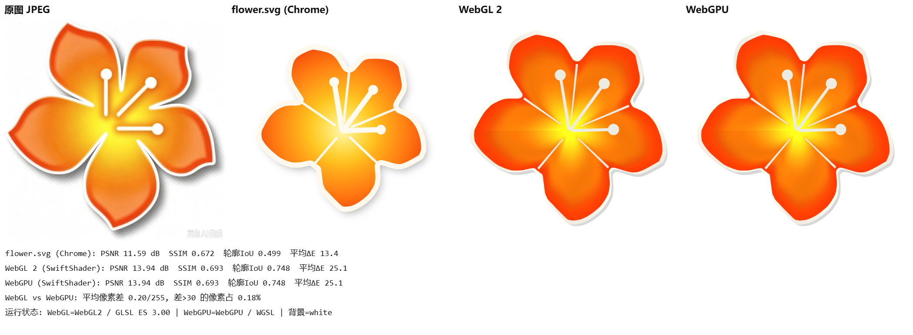

# Web 端矢量渲染性能对比与自动化基准

> 二期进行中 · 2026.11 – 至今（预计 2026.12 完成）

以同一张花朵图像为唯一输入，对比三条输出路径：**可编辑矢量（SVG）**、**WebGL 2 / WebGPU 双 GPU 管线实时渲染**、**图生视频模型生成的栅格短片**。关注点不是「哪个更好看」，而是把「形状能否编辑、能否任意缩放、能否参数化、渲染结果是否可复现」变成可测量的指标。



## 在线演示

- **GitHub Pages**：https://wwz666-wake.github.io/vector-rendering-benchmark/
- **本地**：直接双击 `index.html` 即可，样式、脚本与源图全部内联，不需要服务器、不需要联网、不需要安装依赖

页面支持暂停动画、调整旋转速度、切换白描边 / 花蕊 / 矢量网格 / 控制点，并可下载 SVG 与矢量 JSON。若浏览器禁用 WebGPU，可在本目录执行 `python -m http.server 8000` 后访问 `http://127.0.0.1:8000/index.html`；WebGPU 不可用时左侧 WebGL 2 仍独立运行并显示原因。

## 当前状态

| 阶段 | 内容 | 状态 |
|---|---|---|
| 一期 | 轮廓提取、矢量化、双 GPU 管线、像素级验证 | 已完成 |
| 二期 | 固定输入集、自动采集指标、结构化结果表 | 进行中 |
| 三期 | 多分辨率 / 轮廓复杂度分组，量化适用场景 | 计划中 |

**已完成**：从 1280×1280 原图完成颜色分割、径向轮廓提取、RDP 简化与 Catmull-Rom 细分，输出 `flower.svg`（84 个控制点 / 420 个轮廓点）与 6,582 个三角形的几何数据；用同一份 `Float32Array` 分别驱动 WebGL 2（GLSL ES 3.00）与 WebGPU（WGSL，4× MSAA）两条独立管线；用无头 Chrome 读回真实渲染像素完成 PSNR / SSIM / 轮廓 IoU / ΔE 验证。

**进行中**：把一次性实验改造成可重复运行的基准——已先把验证指标结构化为 `results/metrics.csv`，下一步固定输入集与自动采集流程（见 [docs/ROADMAP.md](docs/ROADMAP.md)）。

**下一步**：增加多分辨率与轮廓复杂度分组，给出量化适用场景结论。

## 核心结果

指标由 `tools/probe.js` 在页面内用 Canvas 2D 计算，以 512×512 白底原图为参照；GPU 像素通过 `readPixels` / `copyTextureToBuffer` 读回，而非截取画布。

| 渲染方式 | PSNR | SSIM | 轮廓 IoU | 平均 ΔE |
|---|---|---|---|---|
| `flower.svg`（Chrome） | 11.59 dB | 0.672 | 0.499 | 13.4 |
| WebGL 2（SwiftShader） | 13.94 dB | 0.693 | 0.748 | 25.1 |
| WebGPU（SwiftShader） | 13.94 dB | 0.693 | 0.748 | 25.1 |

WebGL 2 与 WebGPU 输出的平均像素差为 **0.20/255**，差值 > 30 的像素占 0.18%，说明两条管线渲染的是同一份几何。结构化数据见 [`results/metrics.csv`](results/metrics.csv)，完整口径与原始状态见 [`verify/metrics.txt`](verify/metrics.txt)。

## 目录结构

```
vector-rendering-benchmark/
├── index.html                  自包含对比页（GitHub Pages 首页）
├── compare.png                 四联对比效果图
├── flower.svg                  可编辑矢量结果
├── flower_geometry.json        完整几何快照（含三角化顶点缓冲）
├── assets/                     输入原图与 AI 生成短片
├── tools/                      生成与验证脚本
│   ├── build.py                生成自包含 index.html
│   ├── verify.py               导出 SVG / 几何 / 对比图 / 验证截图
│   ├── probe.js                页内像素指标探针
│   └── shot.mjs                无头 Chrome 真实等待与截图
├── verify/                     白底 / 深底渲染像素与页面截图
├── results/metrics.csv         结构化指标表
├── docs/
│   ├── experiment-report.md    一期完整技术报告（实现细节与局限）
│   └── ROADMAP.md              二期进度与验收标准
└── LICENSE
```

## 复现

```bash
python tools/build.py     # 生成自包含 index.html
python tools/verify.py    # 导出 flower.svg / flower_geometry.json / compare.png / verify/
```

`verify.py` 需要 Node 22 与 Chrome / Edge，不依赖 numpy、OpenCV 或其他 Python 包。`tools/shot.mjs` 用 Node 22 内置的 CDP/WebSocket 真实等待探针完成，不依赖 puppeteer。

## 技术要点

- **矢量化**：320×320 采样 → 颜色分割（`S > 0.18`、`R−B > 42`、`R > 145`）与形态学闭运算 → 240 个径向角度求最外侧花色像素 → 中值滤波与圆周平滑 → RDP 自适应简化 → 闭合三次贝塞尔路径
- **GPU 几何**：轮廓点构建 7 层径向扇形网格，每顶点 10 个 float（位置 2 / 颜色 4 / 参数 4），渐变、光晕、白描边与动画全部在着色器中计算
- **可复现性验证**：WebGL 与 WebGPU 使用完全相同的 uniform 参数与顶点缓冲，差异以像素级指标量化
- **对照组**：AI 生成 5.2 秒短片保留玻璃质感，但几何不可编辑、分辨率固定、逐帧不确定

完整实现细节、验证方法与已知局限见 [一期技术报告](docs/experiment-report.md)。

## 局限

径向轮廓法保留的是「形状与配色逻辑」，没有逐像素复刻原图的玻璃质感与花瓣内部明暗，因此 PSNR 约 14 dB；白描边与花蕊按语义重建而非精确追踪。无头环境使用 SwiftShader 软件渲染，页面上的 FPS 只作参考，真实 GPU 性能需在带显卡的浏览器中确认。

## License

MIT — 输入图像与 AI 生成短片仅用于本实验的技术对照。
